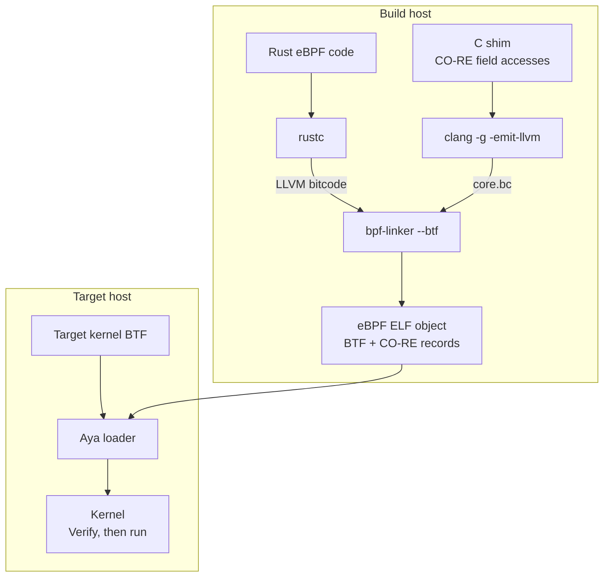

# Rust with C shims

With native Rust CO-RE support still in development, C shims provide a
practical workaround for using CO-RE while keeping the main eBPF logic in Rust.

Start by checking whether a BPF helper or a program's context already exposes
the information you need. For example, `bpf_get_current_pid_tgid` provides the
current task's process and thread IDs without reading `task_struct` fields.

When you need to read internal kernel structures, a C shim can use Clang's
CO-RE support for the field accesses while Rust handles filtering, maps, and
events. Pass kernel object pointers across the interface as opaque pointers,
and return scalars or application-defined structures. Keep accesses to kernel
fields inside the C shim so that Rust does not reintroduce fixed offsets.

For example, a hook that receives a pointer to another task can read its PID
through the following shim in `core.c`:

```c
#include "vmlinux.h"
#include <bpf/bpf_helpers.h>
#include <bpf/bpf_core_read.h>

int read_task_pid_core(const void *task, int *pid)
{
    const struct task_struct *t = task;
    return BPF_CORE_READ_INTO(pid, t, pid);
}
```

`BPF_CORE_READ_INTO` records the field access for relocation and uses
`bpf_probe_read_kernel` to perform the read. Its return value allows the caller
to handle a failed memory read. For other accesses, including optional fields
and bitfields, see the [BPF CO-RE reference guide][co-re-reference].

The Rust eBPF code can declare the shim and wrap its result:

```rust,ignore
use core::ffi::c_void;

unsafe extern "C" {
    fn read_task_pid_core(task: *const c_void, pid: *mut i32) -> i32;
}

fn read_task_pid(task: *const c_void) -> Result<i32, i32> {
    let mut pid = 0;
    // SAFETY: `pid` is valid writable storage, and the shim uses
    // `bpf_probe_read_kernel` to handle invalid source addresses.
    let ret = unsafe { read_task_pid_core(task, &mut pid) };
    if ret == 0 {
        Ok(pid)
    } else {
        Err(ret)
    }
}
```

These snippets show the interface between the two languages; the Rust wrapper
belongs in your eBPF crate and must be called by your program. The C shim runs
as part of the eBPF program, and is subject to the same verifier restrictions.

## Building the shim

`bpf-linker` accepts the C shim's LLVM bitcode as an additional input alongside
the Rust bitcode. The shim provides the information needed to emit CO-RE
relocation records for its kernel field accesses.



The C and Rust code become one eBPF object. Aya applies its CO-RE relocations
on the target host using that kernel's BTF.

Install the libbpf development headers for `bpf_helpers.h` and
`bpf_core_read.h`. These are build dependencies; Aya remains the userspace loader.
Generate `vmlinux.h` from a kernel BTF file containing the types used by the shim,
then compile the C code to LLVM bitcode:

```console
bpftool btf dump file /sys/kernel/btf/vmlinux format c > vmlinux.h
clang -target bpfel -O2 -g -emit-llvm -c core.c -o core.bc
```

Use `bpfeb` instead of `bpfel` for a big-endian BPF target. The BTF used to
generate this header describes the build-time types; Aya uses the deployment
kernel's BTF to relocate the resulting object at load time.

Pass `core.bc` as an additional input to `bpf-linker` when building the Rust
eBPF crate. For a direct Cargo build, replace the path below with the absolute
path to your bitcode file:

```console
RUSTFLAGS="-C debuginfo=2 -C link-arg=--btf -C link-arg=/path/to/core.bc" \
    cargo +nightly build --release \
    --target bpfel-unknown-none -Z build-std=core
```

Run this command for the eBPF crate. For big-endian targets, also change the
Rust target to `bpfeb-unknown-none`. The build needs the `rust-src` component
described in [Development Environment](../../start/development.md).

Use a Clang version compatible with the LLVM used by your Rust toolchain and
`bpf-linker`, and pin these tools together for reproducible builds. See
[`bpf-linker`'s LLVM requirements][linker-llvm]. The final object needs both BTF
type information and the CO-RE relocation records produced by the C shim;
`--btf` enables their emission by the linker.

Load the final object with Aya as usual. A separate C userspace loader is not
needed.

## Verifying the result

Use [`llvm-objdump`][llvm-objdump] from LLVM 18 or newer to inspect the final
eBPF ELF produced by the Rust build. Replace the path below with that artifact:

```console
llvm-objdump -dr /path/to/your-ebpf-program
```

`-d` disassembles the program and `-r` adds relocation annotations. For the
PID shim above, look for a record like this:

```text
0000000000000018:  CO-RE <byte_off> [7] struct task_struct::pid (0:94)
```

`<byte_off>` identifies a field-offset relocation for `task_struct.pid`. The
instruction offset, BTF type ID (`[7]`), and field access path (`0:94`) vary
with the build.

The presence of `.BTF` and `.BTF.ext` sections alone is insufficient:
`.BTF.ext` can contain function and line information without CO-RE records.

Test the same eBPF object on kernels whose layouts differ for the fields your
program reads, and check the values it reports. Rebuilding the object on each
test kernel would hide dependencies on compile-time offsets.

Your program must still handle changes in field meaning and missing kernel
features, such as helpers and attachment points.

[co-re-reference]: https://nakryiko.com/posts/bpf-core-reference-guide/
[linker-llvm]: https://github.com/aya-rs/bpf-linker/blob/main/BUILDING.md#llvm
[llvm-objdump]: https://llvm.org/docs/CommandGuide/llvm-objdump.html
