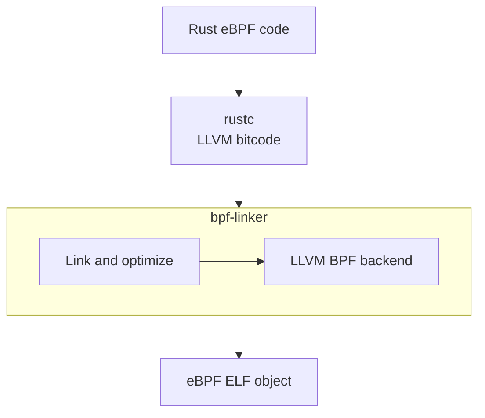
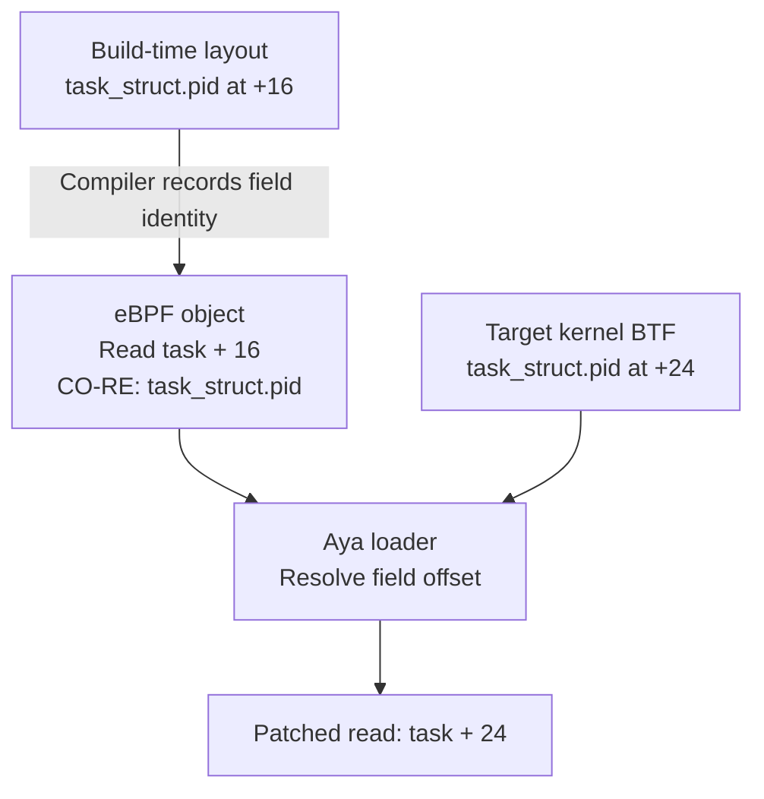

# CO-RE support in Rust and Aya

CO-RE spans the build and load stages. Compilers preserve the type and field
information needed for relocation, and the build produces an eBPF object
containing CO-RE records. At load time, Aya uses those records and the target
kernel's BTF to adapt the program.

| Component | Responsibility | Status |
| --- | --- | --- |
| Rust compiler | Describe relocatable kernel accesses in Rust eBPF code. | [In development][rust-tracking]. |
| [`bpf-linker`](#bpf-linker) | Link LLVM bitcode and emit an eBPF object. | BTF emission supported; CO-RE emission requires metadata from the compiler. |
| Aya loader | Apply CO-RE relocation records to an eBPF object. | Supported. |

This means Aya can already load CO-RE programs compiled from C. To use CO-RE
from a Rust eBPF program today, you can put the kernel field accesses in
[C shims](rust-with-c-shims.md) and keep the rest of the program in Rust.

The status above was checked on October 19, 2026. Follow the linked upstream
work for updates.

## Rust's compiler

BTF output for Rust eBPF programs is already available through `bpf-linker`.
Native Rust support for producing CO-RE relocations is still in development.
For details of the proposed language support and design discussions, see
the [pre-RFC discussion on Rust Internals][rust-internals] and
[RFC #3966][rust-rfc]. Implementation progress is tracked in
[issue #160616][rust-tracking]. The proposed APIs are still evolving.

BTF describes types and their layouts. CO-RE relocation records additionally
connect specific instructions to the types and fields they query. The Rust
compiler work linked above focuses on generating the information needed for
these records. Enabling BTF output alone does not create them for ordinary
Rust field accesses.

Ordinary Rust field accesses use the type layout determined at compile time.
For example, suppose `pid` is at byte offset 16 in the Rust definition of
`task_struct`. An access such as `(*task).pid` can compile to a read from
`task + 16`. The instruction contains the offset, but does not identify the
field as `task_struct.pid`.

If `pid` is at byte offset 24 on the target kernel, a
[CO-RE relocation record][co-re-record] tells Aya's loader which instruction
accesses that field, allowing it to change the offset from 16 to 24. Without
this record, the access still uses offset 16.

## bpf-linker

[`bpf-linker`][bpf-linker] links and optimizes LLVM bitcode produced by the
Rust compiler, then uses LLVM's BPF backend to emit an eBPF ELF object.
A Rust eBPF build follows this flow:

With debug information and `--btf` enabled, `bpf-linker` also emits BTF.
Before emission, it adjusts Rust debug information for kernel BTF compatibility.
For example, kernels that require C-style BTF type names would reject Rust
names such as `Foo<u8>`, so `bpf-linker` rewrites them. See the
[upstream discussion][linker-btf-fixups] for details of these fixes.

The same `--btf` option enables CO-RE relocation emission, but this depends on
the compiler preserving the required type and field access information.

Because it links LLVM bitcode, the LLVM version used by `bpf-linker` must
match the one used by the Rust compiler. See its
[LLVM requirements][linker-llvm] when choosing a toolchain.

## Aya's loader

Aya's userspace loader implements CO-RE relocations. It uses the type information
and relocation records in an eBPF object together with the target kernel's BTF
to adjust the program before submitting it to the kernel. This works with
CO-RE objects produced by Clang, including objects containing both Rust and C
code, without a runtime dependency on libbpf.

By default, Aya reads the target BTF from `/sys/kernel/btf/vmlinux` when it is
needed. You can also supply BTF explicitly through [`EbpfLoader::btf`][loader-btf].
That BTF must describe the kernel on which the program will run. For the
supported relocation kinds, see [Aya's relocation implementation][aya-relocations].

CO-RE can also resolve field sizes, signedness, bitfield shifts, type sizes,
BTF type IDs and enum values. It can test whether fields, types and enum values
exist, allowing programs to choose explicit fallbacks. See the
[CO-RE relocation kinds][co-re-kinds] for details.

> [!NOTE]
> Aya's loader supports kernel symbol resolution (`__ksym` externs, including
> kfunc calls). It does not yet support `struct_ops` registration. These
> capabilities are separate from CO-RE relocations and have their own kernel
> requirements.

[co-re-kinds]: https://docs.kernel.org/bpf/llvm_reloc.html#relocation-kinds
[co-re-record]: https://docs.kernel.org/bpf/llvm_reloc.html#co-re-relocation-record
[loader-btf]: https://docs.rs/aya/latest/aya/struct.EbpfLoader.html#method.btf
[aya-relocations]: https://github.com/aya-rs/aya/blob/main/aya-obj/src/btf/relocation.rs
[rust-rfc]: https://github.com/rust-lang/rfcs/pull/3966
[rust-internals]: https://internals.rust-lang.org/t/pre-rfc-btf-relocations/24161/20
[rust-tracking]: https://github.com/rust-lang/rust/issues/160616
[bpf-linker]: https://github.com/aya-rs/bpf-linker#overview
[linker-btf-fixups]: https://github.com/rust-lang/rust/issues/135175#issuecomment-5306294099
[linker-llvm]: https://github.com/aya-rs/bpf-linker/blob/main/BUILDING.md#llvm
